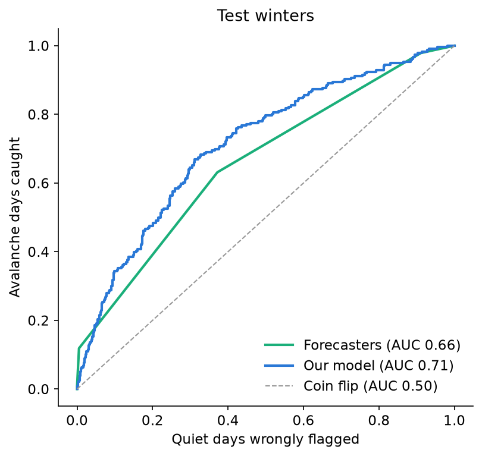
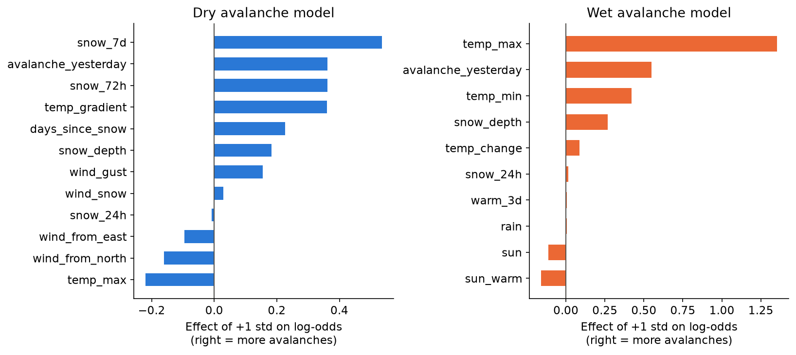
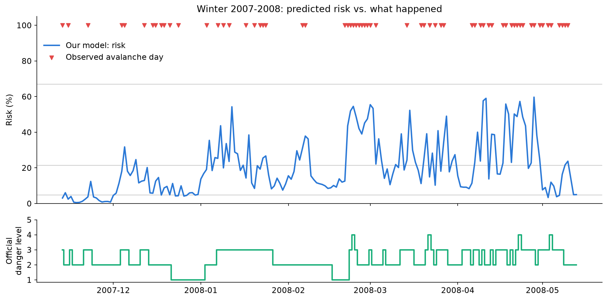
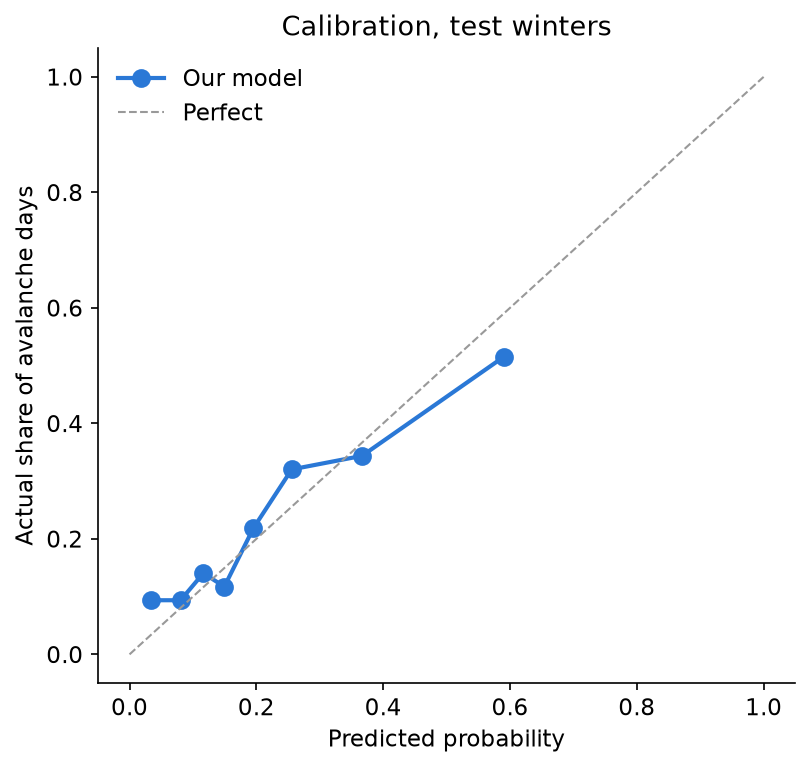

# Avalanche day predictor: Davos

**Question:** how likely are natural avalanches around Davos on a given day, and how does a simple model compare with the official SLF avalanche forecasters?

**Answer:** a logistic regression on daily weather (plus whether avalanches happened yesterday) beats the official danger level in **98% of 200 random train/test splits** (average AUC **0.74 vs 0.69**).

## How to run

```bash
uv sync                                   # install the packages
# download the SLF data (see below) into data/
# open avalanche_model.ipynb in VS Code, select the .venv kernel, Run All
```

The weather is downloaded automatically the first time (Open-Meteo, free, no API key).

## Data

| Source | What | Period |
|---|---|---|
| [SLF: Snow avalanche data Davos](https://www.envidat.ch/dataset/snow-avalanche-data-davos) (doi:10.16904/envidat.134) | One row per winter day: number of avalanches by size, type and trigger, and the official danger level (1-5). Download `avalanche_activity_data.csv` into `data/`. | 1999-2019, 3,533 days |
| [Open-Meteo archive](https://open-meteo.com/en/docs/historical-weather-api) | Daily weather at 2,500 m: snowfall, snow depth, temperature, wind, sun, rain | same days |

**Target:** an *avalanche day* = at least one **natural** avalanche of **size 2+** (big enough to bury a person). 24.8% of days.

## Method

1. **Features** (only today and earlier days, no future data):

| Cause | Features |
|---|---|
| New snow loads the snowpack | snow 24h / 72h / 7d, days since snowfall, snow depth |
| Wind moves snow into slabs | wind, gusts, wind x new snow, wind direction |
| Weak layers (cold air over thin snow) | temperature gradient |
| Warming and sun make snow wet | temp max / min, temp change, warmth 3 days, sun, sun x warmth, rain |
| Avalanche cycles | avalanche yesterday |
| Season | one column per month |

2. **Two logistic regressions:** dry avalanches (driven by snow) and wet avalanches (driven by warmth), combined as P = 1 - (1 - P_dry)(1 - P_wet).
3. **Split by whole winters, at random:** train on 15 winters, test on 6. Whole winters, because neighbouring days are almost identical.
4. **Benchmark:** the official SLF danger level, scored on the same test days.

## Results

One random split (test winters 1999, 2004, 2005, 2008, 2009, 2012):

| | AUC | Hit rate | False alarms |
|---|---|---|---|
| Forecasters (danger level) | 0.66 | 63% | 66% |
| **Our model** | **0.71** | **67%** | **61%** |

Repeated over 200 random splits: model **0.735**, forecasters **0.687**, model better in **98%** of splits.

*AUC: how often an avalanche day gets a higher score than a quiet day (0.5 = coin flip, 1 = perfect). Hit rate: share of avalanche days with a warning. False alarms: share of warnings with no avalanche.*



**What drives the model:** dry avalanches follow new snow over the last week; wet avalanches follow temperature. Avalanches yesterday raise the risk in both.



**One test winter, day by day:** peaks in the predicted risk line up with avalanche cycles and with high official danger levels.





## Limitations

- **Modelled weather:** Open-Meteo is reanalysis for one ~10 km grid cell, not station measurements. Wind is the weakest part (correlation only 0.43 with measured wind at Weissfluhjoch).
- **One yes/no per day for the whole region:** no slope direction, so the effects of wind loading and sun on south slopes cannot be separated. (A model per slope direction was tested and did not help.)
- **Recording changed over time:** about twice as many avalanches were recorded per day after 2015.
- **Avalanche yesterday** needs yesterday's observations, and part of its effect may come from how release dates are estimated.
- **Not a replacement for the official [SLF avalanche bulletin](https://www.slf.ch/en/avalanche-bulletin-and-snow-situation/).**

## Next steps

- A leaner model with fewer, non-overlapping features
- Correct the predicted probabilities (calibration)
- Human-triggered avalanches, i.e. danger to people
- An LLM agent that explains the daily risk in plain language
